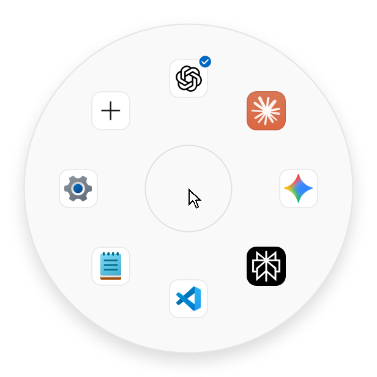
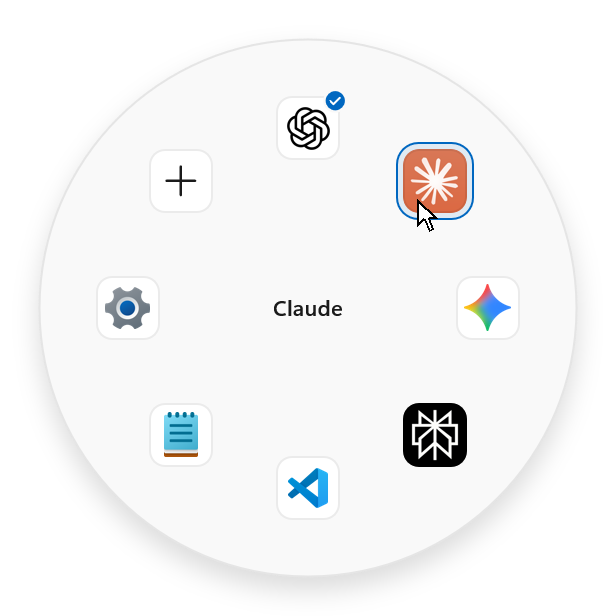
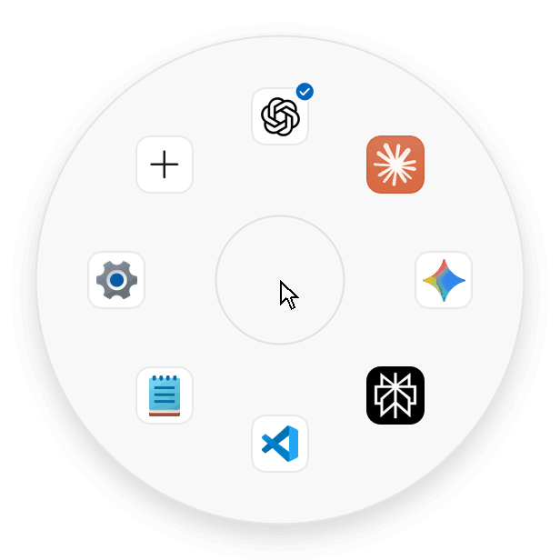
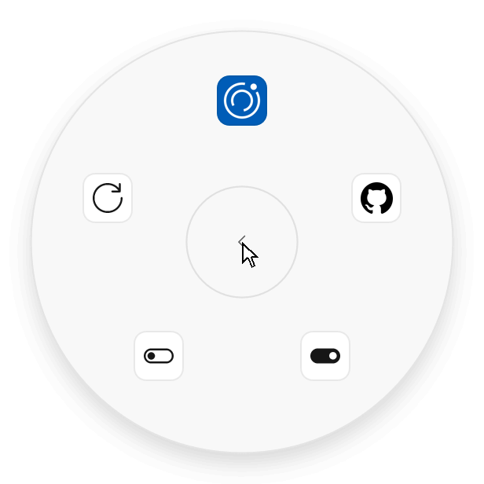

<p align="center">
  <a href="README.md"><picture><source media="(prefers-color-scheme: dark)" srcset="docs/readme/lang-en-off-dark.png"></picture></a>
  <a href="README.zh-CN.md"><picture><source media="(prefers-color-scheme: dark)" srcset="docs/readme/lang-zh-off-dark.png"></picture></a>
  <a href="README.ja.md"><picture><source media="(prefers-color-scheme: dark)" srcset="docs/readme/lang-ja-on-dark.png"></picture></a>
</p>

<p align="center">
  <picture><source media="(prefers-color-scheme: dark)" srcset="docs/readme/demo-hold-dark-ja.gif"></picture>
</p>

<h1 align="center">Copilot Reel</h1>

<p align="center"><b>Copilot キーを押して、指して、離すだけ。</b><br>よく使う AI アプリを、ひとつの動作で。Windows 11 の Copilot キーのための円形ランチャーです。</p>

<p align="center">
  <a href="https://github.com/bakasayaka/copilot-reel/releases/latest"><picture><source media="(prefers-color-scheme: dark)" srcset="docs/readme/download-ja-dark.png"></picture></a><br>
  <sub>Windows 11 · x64 と Arm · 無料</sub>
</p>

<br>

<h2 align="center">使い方</h2>

<table align="center">
  <tr>
    <td align="center" width="240"><picture><source media="(prefers-color-scheme: dark)" srcset="docs/readme/step-open-dark-ja.png"></picture><br><b>1 · 押したまま</b><br><sub><kbd>Copilot</kbd> キーを押したままにすると、ポインターの周りにリールが開きます。</sub></td>
    <td align="center" width="240"><picture><source media="(prefers-color-scheme: dark)" srcset="docs/readme/step-point-dark-ja.png"></picture><br><b>2 · 指す</b><br><sub>アプリの方向へ動かすと、中央に名前が表示されます。</sub></td>
    <td align="center" width="240"><br><b>3 · 離す</b><br><sub>アプリが開きます。起動中のアプリは前面に出ます。</sub></td>
  </tr>
</table>

<p align="center">押したままにせず短く押すと、既定のアプリがすぐに開きます。</p>

<br>

<h2 align="center">ほかのすべては + の中に</h2>

<h3 align="center">言語はその場で切り替え</h3>
<p align="center">English、简体中文、日本語。左右の矢印で言語を切り替えても、アプリの構成は変わりません。</p>
<p align="center"><picture><source media="(prefers-color-scheme: dark)" srcset="docs/readme/demo-hub-dark-ja.gif"></picture></p>

<h3 align="center">ドラッグで並べ替え</h3>
<p align="center">「アプリの管理」でアイコンを新しい位置へドラッグします。中央のごみ箱に落とすとリールから外れ、設定を保ったまま「アプリを追加」で待機します。</p>
<p align="center"><picture><source media="(prefers-color-scheme: dark)" srcset="docs/readme/demo-drag-dark-ja.gif"></picture></p>

<h3 align="center">更新は向こうから</h3>
<p align="center">「バージョン情報」が一日に一度 GitHub に問い合わせます。新しい版が出ると小さな点が付き、「インストール」を選ぶとリールが自動で再起動します。</p>
<p align="center"><picture><source media="(prefers-color-scheme: dark)" srcset="docs/readme/demo-about-dark-ja.gif"></picture></p>

<br>

<h2 align="center">Windows の一部のように</h2>

<p align="center">ダーク モードとライト モード、アクセント カラー、透明効果、コントラスト テーマ。すべて Windows の設定に従い、サインイン時に静かに起動し、キーボードの入力先を奪いません。通知領域のアイコンは、タスク バーに合わせた単色のマークにもできます。右クリックして「モノクロアイコン」をオンにします。</p>

<br>

## はじめに

1. **ダウンロード**：[最新版](https://github.com/bakasayaka/copilot-reel/releases/latest)のページから二つのファイルをダウンロードします。お使いの PC 用のパッケージ（ほとんどの PC は `…_x64.msix`、Windows on Arm は `…_arm64.msix`）と `CopilotReel-Development.cer` です。
2. **証明書を信頼する（初回のみ）**：スタートで **PowerShell** と入力し、**管理者として実行**を選びます。ダウンロード フォルダーに移動して証明書を確認します。表示が `061ED5990CEBC4F2D7C252ABE3EFE7EB99D6239F` でなければ、ここで中止してください。
   ```powershell
   cd $HOME\Downloads
   (Get-PfxCertificate .\CopilotReel-Development.cer).Thumbprint
   ```
   続いて「信頼されたユーザー」に追加します。
   ```powershell
   Import-Certificate -FilePath .\CopilotReel-Development.cer -CertStoreLocation Cert:\LocalMachine\TrustedPeople
   ```
3. **パッケージを開き**、**インストール**を選びます。
4. **キーを割り当てる**：**設定 › 個人用設定 › テキスト入力**の**キーボードの Copilot キーをカスタマイズする**で、**Copilot Reel** を選びます。

> [!TIP]
> 証明書の信頼は PC ごとに一度だけです。以降の新しい版は **+ › バージョン情報** からインストールできます。

> [!NOTE]
> S モードの Windows は Microsoft Store のアプリしかインストールできないため、Copilot Reel はインストールできません。

## よくある質問

<details>
<summary><b>無料ですか？ インターネットに何を送りますか？</b></summary>
<br>
無料で、アカウントも利用状況の送信もありません。自分から行う通信は、一日に一度 GitHub で新しい版を確認することだけで、<b>+ › バージョン情報</b> でオフにできます。
</details>

<details>
<summary><b>リールにはどんなアプリを置けますか？</b></summary>
<br>
アプリ、ショートカット、Web サイトを八つまで置けます。<b>+ › アプリを追加</b> には PC で見つかった AI アプリが並び、一度押すだけで追加できます。ほかのアプリもスタートから選べます。
</details>

<details>
<summary><b>短く押したときに開くアプリはどう決めますか？</b></summary>
<br>
<b>+ › アプリの管理</b> でアプリを選び、<b>既定に設定</b> を選びます。そのアイコンに小さなチェックが付きます。
</details>

<details>
<summary><b>キーボードに Copilot キーがありません。</b></summary>
<br>
<kbd>Ctrl</kbd> + <kbd>Alt</kbd> + <kbd>R</kbd> を押すか、通知領域のリールのアイコンをクリックし、アプリをクリックで選びます。
</details>

<details>
<summary><b>なぜ証明書が必要なのですか？</b></summary>
<br>
パッケージは有料の証明書ではなく、このプロジェクト独自の証明書で署名されています。Windows は信頼する発行元の署名付きパッケージだけをインストールするため、この発行元を一度だけ信頼するよう設定します。
</details>

<details>
<summary><b>アンインストールするには？</b></summary>
<br>
<b>設定 › アプリ › インストールされているアプリ</b> で Copilot Reel をアンインストールし、管理者として実行した PowerShell で証明書を削除します。

```powershell
Get-ChildItem Cert:\LocalMachine\TrustedPeople | Where-Object Thumbprint -eq '061ED5990CEBC4F2D7C252ABE3EFE7EB99D6239F' | Remove-Item
```
</details>

<br>

<p align="center"><sub>作者 baka_sayaka · <a href="docs/development.md">開発者向け資料（英語）</a> · 日本語の表示には Noto Sans JP をもとにした Reel Sans JP を <a href="assets/fonts/OFL.txt">SIL Open Font License</a> のもとで使用しています</sub></p>
