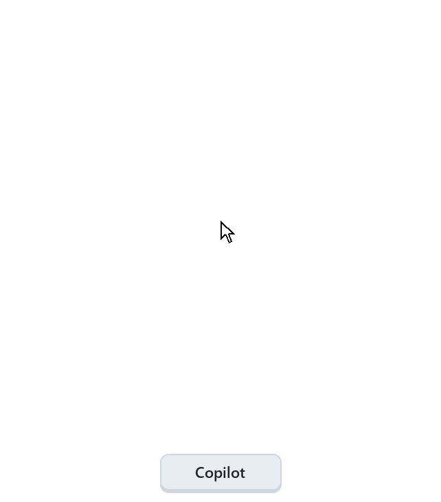
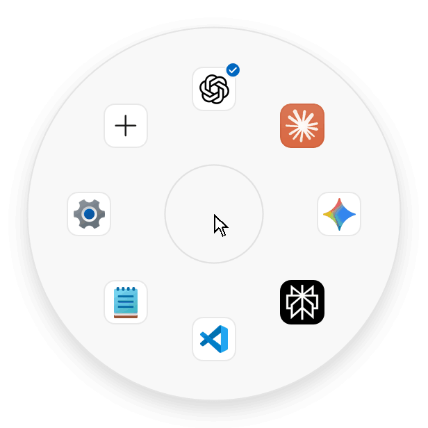
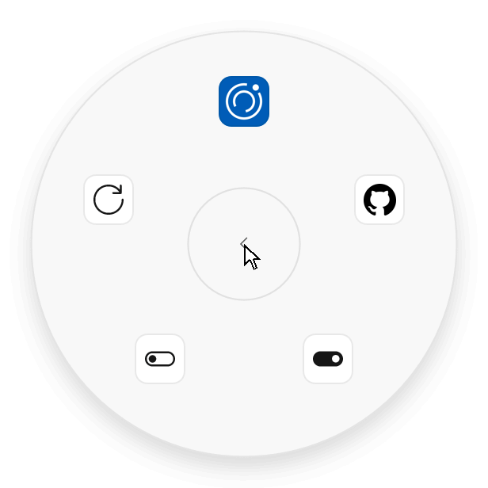

<p align="center">
  <a href="README.md"><picture><source media="(prefers-color-scheme: dark)" srcset="docs/readme/lang-en-on-dark.png"></picture></a>
  <a href="README.zh-CN.md"><picture><source media="(prefers-color-scheme: dark)" srcset="docs/readme/lang-zh-off-dark.png"></picture></a>
  <a href="README.ja.md"><picture><source media="(prefers-color-scheme: dark)" srcset="docs/readme/lang-ja-off-dark.png"></picture></a>
</p>

<p align="center">
  <picture><source media="(prefers-color-scheme: dark)" srcset="docs/readme/demo-hold-dark-en.gif"></picture>
</p>

<h1 align="center">Copilot Reel</h1>

<p align="center"><b>Hold the Copilot key. Point. Let go.</b><br>Your AI apps, one gesture away: a radial launcher made for the Copilot key on Windows 11.</p>

<p align="center">
  <a href="https://github.com/bakasayaka/copilot-reel/releases/latest"><picture><source media="(prefers-color-scheme: dark)" srcset="docs/readme/download-en-dark.png"></picture></a><br>
  <sub>Windows 11 · x64 and Arm · free</sub>
</p>

<br>

<h2 align="center">How it works</h2>

<table align="center">
  <tr>
    <td align="center" width="240"><picture><source media="(prefers-color-scheme: dark)" srcset="docs/readme/step-open-dark-en.png"></picture><br><b>1 · Hold</b><br><sub>Hold <kbd>Copilot</kbd>. The reel opens around your pointer.</sub></td>
    <td align="center" width="240"><picture><source media="(prefers-color-scheme: dark)" srcset="docs/readme/step-point-dark-en.png"></picture><br><b>2 · Point</b><br><sub>Move toward an app. Its name appears in the middle.</sub></td>
    <td align="center" width="240"><br><b>3 · Let go</b><br><sub>The app opens, or comes to the front if it is already running.</sub></td>
  </tr>
</table>

<p align="center">A short tap, without holding, opens your favorite app right away.</p>

<br>

<h2 align="center">Everything else is behind +</h2>

<h3 align="center">Your language, in place</h3>
<p align="center">English, 简体中文 and 日本語. The arrows switch the language; your apps stay exactly as they are.</p>
<p align="center"><picture><source media="(prefers-color-scheme: dark)" srcset="docs/readme/demo-hub-dark-en.gif"></picture></p>

<h3 align="center">Arrange by dragging</h3>
<p align="center">In Manage apps, drag a tile to a new place. Drop it on the trash to take it out of the reel; it waits on Add with its settings.</p>
<p align="center"><picture><source media="(prefers-color-scheme: dark)" srcset="docs/readme/demo-drag-dark-en.gif"></picture></p>

<h3 align="center">Updates come to you</h3>
<p align="center">About asks GitHub once a day. When a new version is out, a small dot appears; choose Install and the reel restarts by itself.</p>
<p align="center"><picture><source media="(prefers-color-scheme: dark)" srcset="docs/readme/demo-about-dark-en.gif"></picture></p>

<br>

<h2 align="center">Feels like part of Windows</h2>

<p align="center">Light or dark, your accent color, transparency and high contrast: the reel follows your Windows settings, starts quietly when you sign in and never takes your keyboard focus. Its notification-area icon can be a single-color mark that matches the taskbar: choose Tray icon under +, or right-click the icon and check Monochrome icon.</p>

<br>

## Get started

1. **Download** two files from the [latest release](https://github.com/bakasayaka/copilot-reel/releases/latest): the package for your PC (`…_x64.msix` for most PCs, `…_arm64.msix` for Windows on Arm) and `CopilotReel-Development.cer`.
2. **Trust the certificate once.** Open Start, type **PowerShell**, and choose **Run as administrator**. Go to your downloads and check the certificate. It must print `061ED5990CEBC4F2D7C252ABE3EFE7EB99D6239F`; if it prints anything else, stop.
   ```powershell
   cd $HOME\Downloads
   (Get-PfxCertificate .\CopilotReel-Development.cer).Thumbprint
   ```
   Then add it to Trusted People:
   ```powershell
   Import-Certificate -FilePath .\CopilotReel-Development.cer -CertStoreLocation Cert:\LocalMachine\TrustedPeople
   ```
3. **Open the package** and choose **Install**.
4. **Give it the key.** In **Settings › Personalization › Text input**, under **Customize Copilot key on keyboard**, choose **Copilot Reel**.

> [!TIP]
> The certificate is needed only once per PC. Later versions install from **+ › About**.

> [!NOTE]
> Windows in S mode installs only apps from the Microsoft Store, so it cannot install Copilot Reel.

## Questions

<details>
<summary><b>Is it free? What does it send over the internet?</b></summary>
<br>
It is free, with no account and no telemetry. The only request it makes by itself is a daily check on GitHub for a newer version, which you can turn off in <b>+ › About</b>.
</details>

<details>
<summary><b>Which apps can I put in the reel?</b></summary>
<br>
Up to eight apps, shortcuts or websites. <b>+ › Add app</b> offers the AI apps it finds on your PC, one tap each, and lets you pick any other app from Start.
</details>

<details>
<summary><b>How do I choose what a short tap opens?</b></summary>
<br>
Open <b>+ › Manage apps</b>, choose the app and then <b>Set as preferred</b>. Its tile shows a small check.
</details>

<details>
<summary><b>My keyboard has no Copilot key.</b></summary>
<br>
Press <kbd>Ctrl</kbd> + <kbd>Alt</kbd> + <kbd>R</kbd>, or click the reel's icon in the notification area, and choose an app with a click.
</details>

<details>
<summary><b>Why does it need a certificate?</b></summary>
<br>
The package is signed with the project's own certificate instead of a paid one. Windows installs a signed package only from a publisher it trusts, so you tell it to trust this one, once.
</details>

<details>
<summary><b>How do I remove it?</b></summary>
<br>
Uninstall Copilot Reel in <b>Settings › Apps › Installed apps</b>. Then remove the certificate from PowerShell opened with <b>Run as administrator</b>:

```powershell
Get-ChildItem Cert:\LocalMachine\TrustedPeople | Where-Object Thumbprint -eq '061ED5990CEBC4F2D7C252ABE3EFE7EB99D6239F' | Remove-Item
```
</details>

<br>

<p align="center"><sub>Made by baka_sayaka · <a href="docs/development.md">For developers</a> · Japanese text set in Reel Sans JP, from Noto Sans JP under the <a href="assets/fonts/OFL.txt">SIL Open Font License</a></sub></p>
