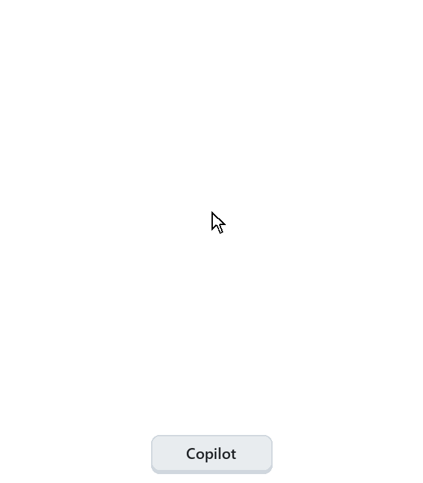
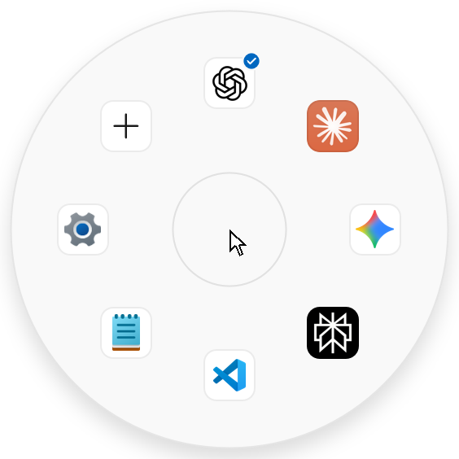
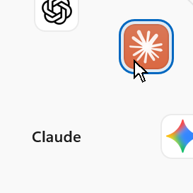
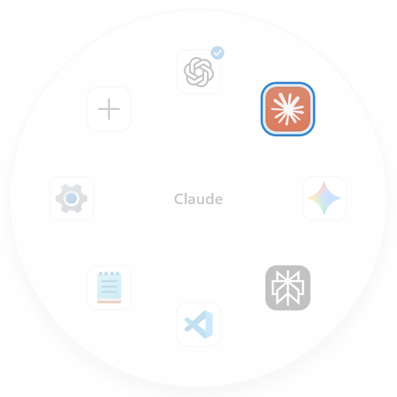
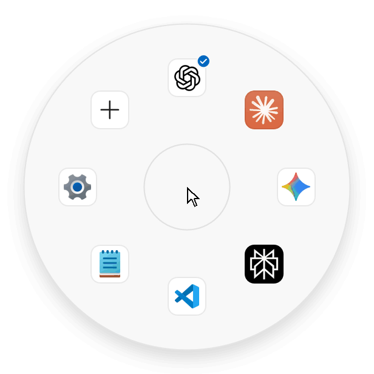
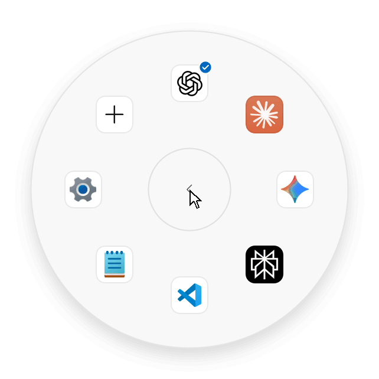
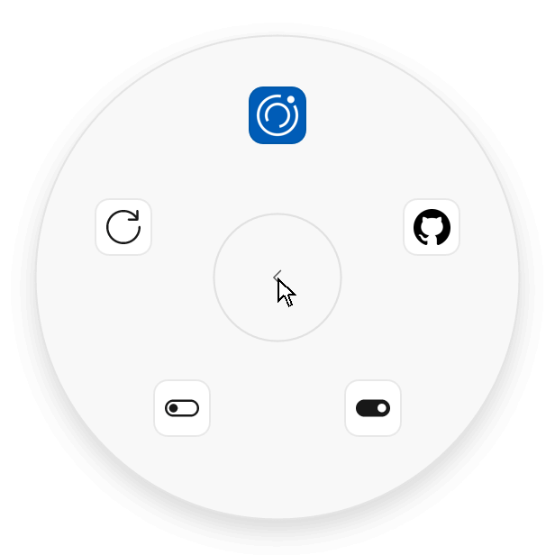

<p align="center">
  <a href="README.md"><picture><source media="(prefers-color-scheme: dark)" srcset="docs/readme/lang-en-off-dark.png"></picture></a>
  <a href="README.zh-CN.md"><picture><source media="(prefers-color-scheme: dark)" srcset="docs/readme/lang-zh-on-dark.png"></picture></a>
  <a href="README.ja.md"><picture><source media="(prefers-color-scheme: dark)" srcset="docs/readme/lang-ja-off-dark.png"></picture></a>
</p>

<p align="center">
  <picture><source media="(prefers-reduced-motion: reduce) and (prefers-color-scheme: dark)" srcset="docs/readme/demo-hold-dark-zh.png"><source media="(prefers-reduced-motion: reduce)" srcset="docs/readme/demo-hold-light-zh.png"><source media="(prefers-color-scheme: dark)" srcset="docs/readme/demo-hold-dark-zh.gif"></picture>
</p>

<h1 align="center">Copilot Reel</h1>

<p align="center"><b>按住 Copilot 键，指向，松开。</b><br>常用的 AI 应用，一个手势就到：为 Windows 11 的 Copilot 键打造的轮盘启动器。</p>

<p align="center">
  <a href="https://github.com/bakasayaka/copilot-reel/releases/latest"><picture><source media="(prefers-color-scheme: dark)" srcset="docs/readme/download-zh-dark.png"></picture></a><br>
  <sub>Windows 11 · x64 与 Arm · 免费</sub>
</p>

<br>

<h2 align="center">怎么用</h2>

<table align="center">
  <tr>
    <td align="center" width="260"><picture><source media="(prefers-color-scheme: dark)" srcset="docs/readme/step-open-dark.png"></picture><br><b>1 · 按住</b><br><sub>按住 <kbd>Copilot</kbd> 键，轮盘在指针周围展开。</sub></td>
    <td align="center" width="260"><picture><source media="(prefers-color-scheme: dark)" srcset="docs/readme/step-point-dark.png"></picture><br><b>2 · 指向</b><br><sub>朝应用的方向移动，中央会显示它的名称。</sub></td>
    <td align="center" width="260"><picture><source media="(prefers-color-scheme: dark)" srcset="docs/readme/step-launch-dark.png"></picture><br><b>3 · 松开</b><br><sub>应用随即打开；已在运行的会直接切到前台。</sub></td>
  </tr>
</table>

<p align="center">不按住、只轻按一下，就直接打开你的首选应用。</p>

<br>

<h2 align="center">其余一切，都在 + 里</h2>

<h3 align="center">语言，原地切换</h3>
<p align="center">English、简体中文和日本語。用两侧的箭头切换语言，你的应用保持原样。</p>
<p align="center"><picture><source media="(prefers-reduced-motion: reduce) and (prefers-color-scheme: dark)" srcset="docs/readme/demo-hub-dark-zh.png"><source media="(prefers-reduced-motion: reduce)" srcset="docs/readme/demo-hub-light-zh.png"><source media="(prefers-color-scheme: dark)" srcset="docs/readme/demo-hub-dark-zh.gif"></picture></p>

<h3 align="center">拖一拖，就排好</h3>
<p align="center">在「管理应用」里把图标拖到新位置；拖到中央的垃圾桶上，就把它移出轮盘，它会带着原有设置在「添加应用」里等你。</p>
<p align="center"><picture><source media="(prefers-reduced-motion: reduce) and (prefers-color-scheme: dark)" srcset="docs/readme/demo-drag-dark-zh.png"><source media="(prefers-reduced-motion: reduce)" srcset="docs/readme/demo-drag-light-zh.png"><source media="(prefers-color-scheme: dark)" srcset="docs/readme/demo-drag-dark-zh.gif"></picture></p>

<h3 align="center">更新，自己找上门</h3>
<p align="center">「关于」每天向 GitHub 询问一次。有新版本时会出现一个小圆点，选择「安装」，轮盘会自行重启。</p>
<p align="center"><picture><source media="(prefers-reduced-motion: reduce) and (prefers-color-scheme: dark)" srcset="docs/readme/demo-about-dark-zh.png"><source media="(prefers-reduced-motion: reduce)" srcset="docs/readme/demo-about-light-zh.png"><source media="(prefers-color-scheme: dark)" srcset="docs/readme/demo-about-dark-zh.gif"></picture></p>

<br>

<h2 align="center">像 Windows 自带的一样</h2>

<p align="center">深色或浅色、强调色、透明效果和高对比度，都跟随 Windows 设置；登录时安静地在后台启动，从不抢走键盘焦点。通知区域的图标也可以换成与任务栏一致的单色标志：在 + 中选择「托盘图标」，或右键单击图标，勾选「单色图标」。</p>

<br>

## 开始使用

1. **下载**：在[最新版本](https://github.com/bakasayaka/copilot-reel/releases/latest)页面下载两个文件：适合你电脑的安装包（大多数电脑用 `…_x64.msix`，Windows on Arm 用 `…_arm64.msix`），以及 `CopilotReel-Development.cer`。
2. **信任证书（只需一次）**：打开「开始」，输入 **PowerShell**，选择**以管理员身份运行**。进入下载文件夹并检查证书，输出必须是 `061ED5990CEBC4F2D7C252ABE3EFE7EB99D6239F`；如果不是，请停止。
   ```powershell
   cd $HOME\Downloads
   (Get-PfxCertificate .\CopilotReel-Development.cer).Thumbprint
   ```
   然后把它加入「受信任的人」：
   ```powershell
   Import-Certificate -FilePath .\CopilotReel-Development.cer -CertStoreLocation Cert:\LocalMachine\TrustedPeople
   ```
3. **打开安装包**，选择**安装**。
4. **把按键交给它**：在**设置 › 个性化 › 文本输入**中，找到**自定义键盘上的 Copilot 键**，选择 **Copilot Reel**。

> [!TIP]
> 每台电脑只需信任一次证书。以后的新版本在 **+ › 关于** 里安装即可。

> [!NOTE]
> S 模式下的 Windows 只能安装 Microsoft Store 中的应用，因此无法安装 Copilot Reel。

## 常见问题

<details>
<summary><b>免费吗？会往网上发送什么？</b></summary>
<br>
免费，不需要账号，也没有遥测。它唯一主动发出的请求，是每天向 GitHub 检查一次有没有新版本，可以在 <b>+ › 关于</b> 里关闭。
</details>

<details>
<summary><b>轮盘里可以放哪些应用？</b></summary>
<br>
最多八个应用、快捷方式或网站。<b>+ › 添加应用</b> 会列出它在你电脑上找到的 AI 应用，点一下就能加入；其他应用也可以从「开始」菜单中挑选。
</details>

<details>
<summary><b>轻按一下打开的是哪个应用？怎么改？</b></summary>
<br>
打开 <b>+ › 管理应用</b>，选中应用后选择<b>设为首选</b>。它的图标上会出现一个小对勾。
</details>

<details>
<summary><b>我的键盘没有 Copilot 键。</b></summary>
<br>
按 <kbd>Ctrl</kbd> + <kbd>Alt</kbd> + <kbd>R</kbd>，或点击通知区域中的轮盘图标，再用鼠标点选应用。
</details>

<details>
<summary><b>为什么需要证书？</b></summary>
<br>
安装包使用项目自己的证书签名，而不是付费购买的证书。Windows 只安装来自受信任发布者的签名安装包，所以需要你告诉它信任这一个，只需一次。
</details>

<details>
<summary><b>怎么卸载？</b></summary>
<br>
在<b>设置 › 应用 › 已安装的应用</b>中卸载 Copilot Reel，然后在以管理员身份运行的 PowerShell 中删除证书：

```powershell
Get-ChildItem Cert:\LocalMachine\TrustedPeople | Where-Object Thumbprint -eq '061ED5990CEBC4F2D7C252ABE3EFE7EB99D6239F' | Remove-Item
```
</details>

<br>

<p align="center"><sub>作者 baka_sayaka · <a href="docs/development.md">开发者文档（英文）</a> · 日文界面使用 Reel Sans JP，源自 Noto Sans JP，遵循 <a href="assets/fonts/OFL.txt">SIL Open Font License</a></sub></p>
