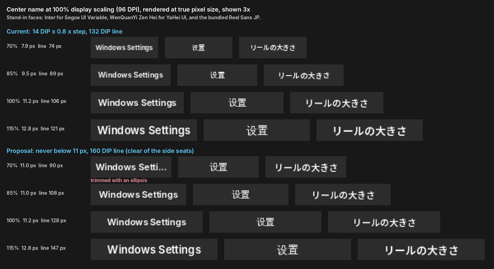
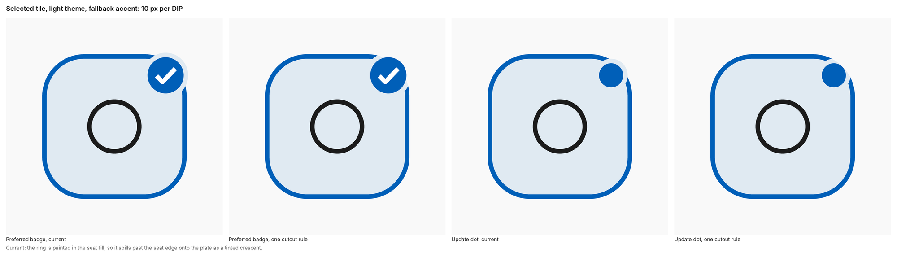
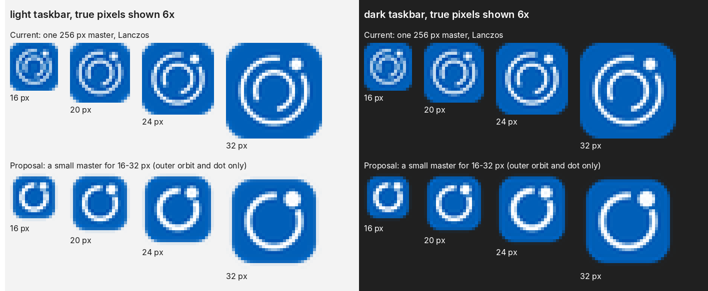

# Design audit and VI v1.0 proposals (2026-10-25)

An audit of the 0.3.8 code and art against VI v0.9, and proposals for the next VI. It is a review, not the design contract: `design/vi/tokens.json` and `docs/visual-identity.md` stay normative until the user accepts a proposal.

Method: the code was read, and the committed captures (`output/runtime/v0.3.8/`, `docs/readme/`, `output/previews/v0.9/`) were measured with Pillow. Nothing was built or run, because the audit ran in a Linux container without the Windows toolchain. Every finding below comes from the source or from measured pixels, and a second reader re-checked the cited lines of the medium and high ones. Items marked *hand check* also need one look on Windows. Line numbers refer to commit `Reproducible Release builds and an installed-only test tier`.

The mockups are illustrations, not VI pages. They use stand-in faces (Inter for Segoe UI Variable, WenQuanYi Zen Hei for Microsoft YaHei UI) and the bundled Reel Sans JP. `mockups/` holds the scripts that drew them, with Pillow and those fonts at their Linux paths: `python mockups/type_floor.py <repo> type-floor.png`, `python mockups/app_icon_small.py <repo> app-icon-small.png` and `python mockups/badge_cutout.py badge-cutout.png` (the badge sheet was then scaled to 2000 px wide).

## What holds up

- **Pixel grid**
  - The effective DPI is a whole number (`src/main.cpp:67-68`).
  - Every surface has an even pixel size, so a snapped center puts the whole surface on the grid (`src/renderer.cpp:461-472`).
  - Item centers and the seat snap with sign-symmetric rounding.
  - Hairlines are whole pixels and inset by half their width (`src/renderer.cpp:576-592`).
- **Text**
  - Grayscale antialiasing suits the premultiplied surfaces.
  - The baseline is snapped from the cap height.
  - CJK names sit within ±0.5 px of the plate center.
  - Names with kana are laid out as ja-JP (`src/renderer.cpp:516-531`).
- **Tokens and motion.** The palettes in `src/vi_tokens.h` match `tokens.json` exactly. Every duration goes through one function, so reduced motion and high contrast both settle at once.
- **Measured color and contrast**
  - The runtime colors match the tokens: plate `#F9F9F9`/`#2C2C2C`, name `#1B1B1B`/`#FFFFFF`, dark tile `#414141`, and the critical roles.
  - WCAG ratios, light / dark:

    | Pair | Light | Dark |
    | --- | --- | --- |
    | Name on plate | 16.36 | 13.97 |
    | Chevrons | 6.25 | 8.96 |
    | Glyph on seat | 14.13 | 9.73 |
    | Armed trash | 5.66 | 10.34 |

- **README parity.** The three READMEs have the same 21 image references, 10 `<picture>` elements and localized alt text, and every referenced path exists.

## Findings

Severity is high, medium (M) or low (L). Nothing in the reel itself is high.

### The radial reel (Direct2D)

| # | Sev | Where | Finding | Fix |
| --- | --- | --- | --- | --- |
| R1 | M | `src/main.cpp:67`, `src/renderer.cpp:345-347` | Text scales with the reel scale and the size step. At 100% display scaling the center name is 11.2 px at the default size, 9.5 px at 85% and 7.9 px at 70%. The Reel size monogram is 9.6 / 8.2 / 6.7 px, and the badge check stroke falls below 1 px at 70%. Chinese and Japanese at 8-10 px grayscale are hard to read. | See proposal P1. |
| R2 | M | `src/renderer.cpp:619-626` | When a badged tile is selected, its badge ring is filled with `selection`. The r 7.5 ring at (+17, -17) reaches 3.4 DIP past the seat's corner (corner arc center (10, -10), r 14), so it paints a tinted crescent on the plate: `#E0EAF2` on `#F9F9F9` in light. This shows on every hover of the preferred agent, the hub's About tile and the update tile. The update dot's own accent disc also runs into the seat stroke (disc edge 28.0 DIP along the diagonal, stroke 26.6-28.1). | P2 |
| R3 | M | `src/appearance.cpp:111`, `src/renderer.cpp:624-626` | High contrast sets accent and selection to the same COLOR_HIGHLIGHT. A focused tile's update dot then disappears, and the check badge loses its disc. | P2. In high contrast a selected tile draws the disc in `selectionText`. |
| R4 | M (frosted) | `src/renderer.cpp:568, 625` | The badge ring is drawn in the opaque `surface` color, while a frosted plate is left transparent, so the "cutout" becomes an opaque halo on acrylic. *Hand check*: window capture omits the backdrop. | P2 |
| R5 | L (frosted) | `src/renderer.cpp:564, 568` | The shadow is knocked out only to r 167, and frosted mode never fills the band from 167 to 168. The rim therefore carries more shadow at the bottom (about 0.84 of the shadow opacity) than at the top. *Hand check.* | Knock out the full radius when the backdrop is on; the rim covers the seam. |
| R6 | L | `src/renderer.cpp:329-336`, `src/vi_tokens.h:70` | The face is always Segoe UI Variable *Text* (opsz 10.5, made for 14 px body text). The reel's text is drawn at caption sizes, where Windows uses Segoe UI Variable *Small*. | P1 |
| R7 | L | `src/renderer.cpp:622` | The badge center is not snapped, but the check inside it is (`src/artwork.cpp:270`). The check can sit 0.5 px off-center in a 9.6 px disc. | Snap the badge center once and use it for the ring, the disc and the check. |
| R8 | L | `src/renderer.cpp:665, 672, 701` | The idle and gated rings are centered on r 44, but the trash ring is inset so that its outer edge is at r 44. They sit 0.5-0.75 DIP apart where they crossfade. | Use the inset convention for all three, as the plate rim does. |
| R9 | L | `src/renderer.cpp:778, 801, 1296` | In high contrast, disabled items keep 0.36 opacity instead of COLOR_GRAYTEXT. That is about 2.5:1 on HC White, below the 3:1 non-text minimum. | Use COLOR_GRAYTEXT at full opacity in high contrast. |
| R10 | L | `src/renderer.cpp:599-602`, `src/artwork.cpp:766` | In high contrast, sun or moon follows the plate's luminance, not the Windows app mode. HC Black over light mode shows a moon. | Pass `appearance.dark` to the command glyph, and keep `DarkPlate()` for vendor variants. |
| R11 | L | `src/renderer.cpp:1218-1219`, `motion.seat` | The seat spring's damping of 0.85 overshoots about 0.6%, roughly 2 DIP on a 180° flick, against "no overshoot". | Damping 1.0 with a period near 45 ms keeps the ~140 ms settle. |
| R12 | L | `src/renderer.cpp:589-592` | At 100% display scaling (effective DPI 54-88), the 1.5 DIP seat stroke rounds to 1 px, the same as the tile hairline. | Keep the accent stroke one pixel heavier than the hairline. |
| R13 | L | `src/renderer.cpp:1276-1279` | A hovered disabled item names itself in `foreground` with no seat, so it reads as choosable. | Draw a disabled item's name in `secondary`. |
| R14 | L | motion | Center content overlaps during the 83 ms crossfades. The outgoing name shows through the back chevron ("Langu‹age" in the hub GIFs). On lift, the name shows under the trash and an empty seat outline stays at the origin slot (`docs/readme/demo-drag-dark-en.gif`, frames 52-53), against "the trash alone owns the center". | P7 |
| R15 | L | `src/renderer.cpp:530` | Text is drawn without `D2D1_DRAW_TEXT_OPTIONS_ENABLE_COLOR_FONT`, so an emoji in a custom name is monochrome. | Add the option. |
| R16 | L | `src/app_types.h:15-18`, `src/core.h:100, 121` | Hit testing copies 384 / 168 / 44 by hand instead of using `vi::kCanvas`, `kPlateRadius` and `kCenterZoneRadius`. They match today, but a token edit would split hit testing from drawing. | Alias the `vi::` values. |

### Artwork classification

| # | Sev | Where | Finding | Fix |
| --- | --- | --- | --- | --- |
| A1 | M | `src/artwork.cpp:366-415` | Windows' stock executable icon passes the plated test (90% coverage on a rounded rectangle). The reference profile's "Probe" app therefore fills the tile, and the r 10 mask clips its side rulings and top bar (`output/runtime/v0.3.8/light-solid-main.png`, near (128, 308)). Every custom executable without its own icon looks like this. | Map stock icons to Generic (E737), and require a plate silhouette for plated art. Add a test and refresh the Probe reference. |
| A2 | L | `src/artwork.cpp:617` | Shell icons are requested at 256 px and scaled down to about 22 px, which skips Windows' hand-tuned 24/32/48 px frames. Settings, Notepad and custom apps are therefore softer than the vendor PNGs. | Request the smallest frame at or above the device target. |

### The editor window and tray menu (GDI)

`ShowOsd` (`src/osd.cpp:1183`) and `ShowSettings` (`src/settings.cpp:766`) have no callers. Their Home, Apps, Appearance, Settings and About pages and the settings window are dead code, which still carries strings such as "Version 0.3.8". Only the focused editor (Editor, Advanced, Choose app) and the tray menu are live.

| # | Sev | Where | Finding | Fix |
| --- | --- | --- | --- | --- |
| E1 | High | `src/main.cpp:1618`, `src/osd.cpp:583, 977-981` | Enter on any focused editor button saves and closes. Owner-drawn buttons report `DLGC_BUTTON`, not a push-button code, so `IsDialogMessageW` sends IDOK. That runs `CompleteEdit` even when Back, Choose app…, Browse… or Advanced has focus. On Choose app, Enter on Back picks the selected app. *Hand check.* | In IDOK, if focus is a BUTTON child, click that button; otherwise run the page's primary action. |
| E2 | High | `src/osd.cpp:433-435, 500, 511-512` | In Choose app, focus stays in Search while Up and Down move the selection, so rows never get `ODS_FOCUS`. The selected row differs from the others only by its fill, at 1.08:1 (light) or 1.33:1 (dark), and Enter picks a row the user cannot see. | Draw the selected row as a seat (selection fill plus a 1.5 DIP accent stroke) whether or not the list has focus (P4). |
| E3 | M | `src/osd.cpp:737, 746` | The viewport is `Px(5 × 34)` tall but each row is `Px(34)`, and `MulDiv` rounds them differently. At 125% the viewport is 213 px and five rows need 215. At 175% it is 298 against 300. The last row loses its bottom edge, which the comment at line 735 forbids. | Viewport height `kListRows × Px(kRowHeight)`. |
| E4 | M | `src/osd.cpp:538-539` | デスクトップ アプリ is 110.7 DIP at 12 DIP in Reel Sans JP (measured) and is trimmed in its 108 DIP column on every desktop-app row. | Size the column from measured `IDWriteTextLayout` widths in the current language. |
| E5 | M | `src/osd.cpp:301, 388-390, 511, 593-596` | Field frames are stroked on whole-DIP edges, so the lines straddle pixels. Buttons and the combo draw at `RectF(1, 1, w-1, h-1)` and fields on their exact rectangle. Choose app… and Browse… therefore look 30 DIP tall beside the 32 DIP field, and Browse ends 1 DIP short of Name. | Use one frame helper: the control's rectangle, inset 0.5 px and snapped. |
| E6 | M | `tokens.json` `outline`, `src/osd.cpp:301, 511` | Field and button borders are `#CCCCCC` on `#F9F9F9` (1.53:1) and `#4A4A4A` on `#2C2C2C` (1.58:1), below the 3:1 non-text contrast of WCAG 1.4.11. | Keep the soft rim and add a 1 px bottom stroke near `secondary`, as WinUI text boxes do. |
| E7 | M | `src/appearance.cpp:109-111`, `src/osd.cpp:497-500, 566-569` | In high contrast, disabled text equals enabled text (`secondary` = WINDOWTEXT). The primary button's fill, stroke and focus ring are all HIGHLIGHT, so focus on it disappears. | Use GRAYTEXT for disabled text, and draw a WINDOWTEXT focus ring outside the fill. |
| E8 | M | `src/typography.h:35-37` | GDI controls in Chinese use Segoe UI with font linking. On a non-Chinese Windows that link list reaches Meiryo UI before YaHei UI, so shared Han (名, 方式) can take Japanese forms next to simplified-only characters. *Hand check.* | `ControlFamily(SimplifiedChinese)` returns Microsoft YaHei UI, as Japanese returns Yu Gothic UI. |
| E9 | M | `src/main.cpp:236, 1204` | Two error messages send the user to "App settings", the dead `ShowSettings` window. The Chinese text says to open it from the tray. | Point them to + › Manage apps › Edit. |
| E10 | L | `src/osd.cpp` (various) | Grid drift: controls are 32 / 34 / 36 DIP tall, labels 23, Advanced 150 wide against side buttons of 112, and corner radii 6 and 7 on the same row. | P4 editor tokens. |
| E11 | L | `src/osd.cpp` (various) | Other details: <ul><li>Button text is 13 DIP against 14 DIP body text.</li><li>Japanese pages mix Yu Gothic UI in the GDI labels with Reel Sans JP in the D2D buttons.</li><li>The primary button carries an accent stroke at rest, the same cue as focus.</li><li>Fewer than five matches leave a gray block under the list.</li><li>After a DPI change the icons stay at the old size.</li><li>Confirmation message boxes are always light.</li></ul> | P4 |
| E12 | L | packaging | Packaging and icon gaps: <ul><li>The tray icon uses `LoadIconW` (`src/main.cpp:1230`), so the shell shrinks the 32 px icon.</li><li>The editor class has no `hIconSm` (`src/osd.cpp:1130`).</li><li>`packaging/app.manifest:3` still says 0.3.3.0.</li><li>`<Resources>` has no ja-JP.</li><li>The tray's English "Quick menu..." uses three periods; the other languages use "…".</li></ul> | P3, and fix the strings. |

### VI document, tokens and generator

**Stale entries**

- **`docs/visual-identity.md`:** still says "0.3.4 build", "15 pages" and specification date 2026-10-20.
- **`design/vi/README.md`:** still says "Soft Orbit for Copilot Reel 0.3.4".
- **`tokens.json`:**
  - `appVersion` is 0.3.4.
  - `supportedLanguages` lacks ja-JP.
  - `osd.language.iconStates` is ["EN", "ZH"], against `typography.iconMonogram.states`.
  - Two descriptions still say "EN/ZH".
  - `colorPolicy.accent` says "only" the seat and badge, but the update dot is accent too.
  - The 24 DIP canvas margin is shorter than the shadow's reach of 32.
- **VI generator:** it still draws the five-item hub with Preferred agent and a Preferred page (`design/vi/source/reel.py:48`, `pages.py:680-686`), and ships `vectors/radial-preferred-*.svg`. It has no About, Reel size, drag/trash, update dot, switch or critical roles.

**Wrong, not just stale**

- `docs/visual-identity.md:131` says Appearance "acts in place". In fact it commits, closes the reel and opens `ms-settings:colors` (`src/main.cpp:999-1000`).
- VI page 5 lays out 23 glyphs in 21 cells, so CheckFailed and Download draw below the footer.
- VI page 5 draws SwitchOn as the raw EC11 pill, without the cut-out knob.
- The WCAG figures use the fallback accent only. The live default ramp (`#0067C0` / `#4CC2FF`) gives seat stroke 5.39 / 6.96 and badge check 5.67 / 10.47. Both still pass.
- `docs/brand-assets.md` omits copilot-reel (plated) and GitHub (glyph, light/dark variants).

### Assets and README art

| # | Sev | Finding |
| --- | --- | --- |
| D1 | M | `packaging/assets/CopilotReel.ico` has one 256 px master Lanczos-downsampled to 16-256, with no 20 or 40. At 16 px the 12/256 arcs are 0.75 px and blur together (P3). |
| D2 | M | The package has only 44, 150 and 50 px logos at scale-100: no `targetsize-*`, `altform-unplated`/`lightunplated` or `scale-*` assets. Windows scales the 44 px logo for the taskbar, Start and the Copilot-key picker. |
| D3 | M | YaHei UI has no 600, so Chinese resolves to Bold beside Segoe 600 and Reel Sans JP 600. In the hub GIFs "语言" has 421 ink pixels against 374 for "言語". The README pills and the Chinese download button show the same jump (P5). |
| D4 | M | The light README uses three blues: the button `#005FB8`, the live seat `#0067C0`, and the dark-theme `#60CDFF` for the keycap and click ring in both themes (`tools/record-demos.py:52`). On white the keycap is 1.80:1. |
| D5 | M | The step stills are 616 px shown at 200, so "Claude" in step 2 is about 7 CSS px, though the caption is about that name. Step 3 (`step-launch.png`) and the hold GIF's finale enlarge the Claude mark beyond the product's motion. That is vendor art used as marketing, beyond "marks identify apps" (`docs/brand-assets.md`). |
| D6 | L | GIF details: <ul><li>The GIFs are baked on `#0d1117` and show a box on GitHub's dimmed and high-contrast themes.</li><li>The 254-color palette posterizes the shadow.</li><li>There is no reduced-motion still.</li><li>The step stills and `demo-hold-light` are byte-identical across languages.</li><li>`tools/readme-art.py` uses static `seguisb.ttf`, not Segoe UI Variable.</li></ul> |

## Proposals for VI v1.0

Every proposal stays inside the project's settled design decisions. Only P1 touches one of them (the size steps), and only to bound text, so it needed the user's approval before any code changes. The user approved P1 on 2026-10-25; the others are not implemented.

### P1. A legibility floor for text

Geometry keeps scaling with `geometry.scale` and the size steps; text stops shrinking at a device-pixel floor:

- the center name never below 11 px;
- the monograms never below 9 px;
- the check stroke never below 1 px;
- the dot radius never below 3 px.

The center line widens from 132 to 160 DIP, which still clears the side seats: the nearest inner seat edge is 82.7 DIP from the center for any slot that reaches the name's 20 DIP band. A face below about 13 px uses Segoe UI Variable Small, with `capRatio` taken from the face actually chosen. A last step of 14 → 13 DIP before trimming would also fit "IntelliJ IDEA Ultimate". Files: `tokens.json` (new `typography.minimumPx`, `geometry.labelWidth`), `src/renderer.cpp`.

**Implemented after approval, not yet built on Windows**

- **Tokens:** `typography.minimumPx` (label 11, monogram 9, maxGrowth 1.5), `typography.small` (Segoe UI Variable Small below 13 px), `geometry.badge.dotMinimumPx` 3, and `typography.applicationLabel.width` 160, generated into `src/vi_tokens.h`.
- **Code:** `FloorDip` and `TextFamilyForPx` in `src/typography.h`. In `src/renderer.cpp`, one text style per role with its own face and cap height, rebuilt on DPI change. The update dot never grows past the check's disc.
- **Not needed:** the badge check already never drops below 1 px, because its stroke is rounded to whole device pixels. The 14 → 13 DIP step is dropped, since the 160 DIP line already fits both names that 132 trimmed.
- **Still to do on Windows:** see `docs/validation.md`.



### P2. One cutout rule for every badge

The badge ring shows what lies beneath it: the seat fill inside the seat, the plate outside, the acrylic when frosted. It never shows a color of its own. This is the rule the switch knob already follows (`src/artwork.cpp:740-742`). Draw tile, art and badge into one raster for the badged items, erase the ring with `D2D1_PRIMITIVE_BLEND_COPY`, and clip it to the seat when selected. In high contrast a selected badge uses `selectionText` for the disc. This fixes R2-R4 and R7. Files: `src/renderer.cpp`, `geometry.badge`.



### P3. An app icon made for small sizes

- **A small master for 16-32 px:** the outer orbit and the dot only, the stroke snapped to whole pixels (1.5 px at 16-20, 2 px at 24-32), and a 1 px keyline inset. The large master stays as is from 48 px.
- **The full MSIX asset set:** `targetsize-16…256` with `altform-unplated` and `altform-lightunplated`, `scale-100…400` for the 44 and 150 logos, ICO frames at 20 and 40.
- **Tray icon:** `LoadIconMetric(LIM_SMALL)`, reloaded on DPI change.

Files: `tools/generate-assets.py`, `packaging/AppxManifest.xml`, `src/main.cpp`.



### P4. The editor as a Soft Orbit sheet

- **One plate.** The caption takes the plate color (`DWMWA_CAPTION_COLOR`, `DWMWA_BORDER_COLOR`), the in-window title and Close go, and the sheet uses `DWMSBT_TRANSIENTWINDOW` when transparency is on.
- **Accent means one thing, as on the plate.**
  - Focus and selection are the seat: selection fill plus a 1.5 DIP accent stroke. This fixes E2.
  - The primary button (Save, Done, Choose) is accent-filled with `textOnAccent`.
  - In high contrast, GRAYTEXT for disabled text and a WINDOWTEXT focus ring (E7).
- **An `editor` block in `tokens.json`,** generated into `vi_tokens.h`:
  - an 8 DIP grid, 32 DIP controls and row and tile radius 10;
  - hairlines inset 0.5;
  - `disabledOpacity` 0.36;
  - field strokes of at least 3:1;
  - a 20/600, 14/400, 12/400 type ramp.

  The VI generator can then draw editor pages too.
- **The reel's iconography.**
  - Segoe Fluent glyphs instead of hand-drawn lines and "›": Back E76B, Advanced E76C, Search E721 in the field, Browse E838.
  - Picker rows show the 40 DIP tile the app will get, drawn with the reel's artwork classes.
- **One text pipeline.** Labels are drawn with D2D in `vi::kTextFamily` with the shared fallback. Text fields load Reel Sans JP with `AddFontResourceExW(FR_PRIVATE)` for Japanese and use YaHei UI for Chinese (E8), so each script looks the same as on the plate.

### P5. Chinese weight parity

Before choosing, compare three Chinese faces next to Segoe UI Variable 600 and Reel Sans JP 600 on VI page 16:

- YaHei UI Bold, as today;
- YaHei UI Regular;
- a Noto Sans SC 600 subset, built by `tools/build-fonts.py` the way Reel Sans JP is.

The choice decides whether a "Reel Sans SC" ships. README art can use the matched face at once. Files: `tools/build-fonts.py`, `src/typography.cpp`, `tools/readme-art.py`.

### P6. One monogram system on the hub

EN/ZH/JA is drawn at 16 DIP and "100%" at 12 DIP, two slots apart. Draw the digits at 16 DIP with a smaller "%" (about 10 DIP) on the same baseline, so both state-in-icon tiles share one cap height.

### P7. Sequenced center content

The center shows one thing at a time:

- the outgoing name clears in 33 ms, as in the handoff, before the back chevron or the trash fades in;
- the seat fades with the lift.

Files: `motion.centerLabel` and `motion.drag` in `tokens.json`, `src/renderer.cpp`.

### P8. Sharper and truer app artwork

- Fix A1 (stock icons become Generic) and A2 (native Shell icon frames).
- Draw the lifted tile from a raster made at 1.08, with a small shadow (the same D2D shadow, about 4 DIP blur). Lifting then reads as elevation, not enlargement.

### P9. Calmer seat motion

Make the seat spring critically damped (R11), so the "no overshoot" rule holds for the seat too.

### P10. A README art pass

- **One accent per theme** across the keycap, the click ring and the button.
- **Step stills** cropped to the plate and shown at 240 px or more, with step 2 as a zoomed detail.
- **Step 3 and the hold finale** made from product pixels (the commit frame), not an enlarged vendor logo.
- **Reduced motion:** `<picture>` sources with `prefers-reduced-motion` stills.
- **Background:** GIFs with transparent or theme-matched edges.
- **Deduplication:** one copy of each language-neutral still.

Files: `tools/record-demos.py`, `tools/readme-art.py`, `README*.md`.

### P11. Regenerate the VI as v1.0, with a guard against drift

- **Content:**
  - Regenerate the scenes for 0.3.8: the six-item hub, About with switches, update dot and Invertocat, Reel size, drag and the armed trash, the JA monogram, and critical roles on page 3.
  - Drop the Preferred page and masters.
  - Fix the page 5 grid and the Appearance wording.
- **Contrast:** quote fallback and live-ramp ratios side by side, and add light-100 and light-150 captures to `tools/capture-seam.py`, with WCAG ratios in its `summary.json`.
- **Guard:** `tools/gen-vi-tokens.ps1 -Check` fails when `iconStates` and `iconMonogram.states` differ, or when `supportedLanguages` misses a shipped locale.

Files: `design/vi/source/*`, `design/vi/vectors/`, `design/vi/stylesheet.typ`, `docs/visual-identity.md`, `tools/gen-vi-tokens.ps1`.

## Developer information in the repository

The same session scanned every blob, commit and tag in the history for personal data.

**What was scanned**

- Text: emails, user-profile and absolute paths, host names, IP addresses, tokens and private keys, SIDs.
- Metadata: PDF and XMP fields, PNG text chunks, GIF comment extensions, SVG metadata.
- Archives: the files inside every committed zip.
- Images: every image larger than a window capture.

**What was found and rewritten in the whole history**

| Where | What | Now |
| --- | --- | --- |
| Author of the merge commit of pull request #1 | the maintainer's personal email address (GitHub used the account's primary email for the web merge) | the GitHub noreply address `60833924+bakasayaka@users.noreply.github.com`, as in every other commit |
| `AGENTS.md` and `CLAUDE.md` | the agents' rules together with a private handoff log: session IDs and transcript paths (one held the contributor's Windows user name), the maintainer's apps and configuration, the local signing and release procedure | every old version removed from the history; `AGENTS.md` is committed again with the rules and settled decisions only, and the handoff log stays on each machine in `AGENTS.local.md`, which `.gitignore` excludes |
| `docs/validation.md` | the contributor's PC model | "an ARM64 Windows 11 PC" |
| `docs/testing-plan.md`, `docs/toolchain.md`, `docs/validation.md` | the absolute path of another local workspace | "a separate checkout outside this repository" / `trace-code-bridge` |

The two rewrites kept every other file, and every commit message, author name and date. The one commit that only added the agent notes ("Add an agent handoff shared by Codex, Claude Code and Cursor") became empty and was dropped. GitHub's signature on the merge commit is gone, because a rewritten commit cannot keep it.

**What was checked and kept**

- **Public identities:** the GitHub accounts and their noreply addresses.
- **Product artwork:** the About credit, the public certificate thumbprint and the package family name.
- **Synthetic test paths:** for example `C:\Users\x`.
- **Vendor material:** the vendor contact in the JetBrains license, and the vendor PNG metadata.
- **Commit timezone offsets** (+01:00 / +02:00).
- **This repository's own folder** `C:\dev\copilot_reel`.
- **The ASUS/OLED test constraint** in `docs/testing-plan.md`.

All binary metadata was clean: the PDFs name the author "anonymous", and the captures are window captures with no desktop, taskbar or personal content.

**State on GitHub**

1. `main` was force-pushed with the rewritten history on 2026-10-25.
2. **The tag still needs moving.** The cloud session's proxy refused tag pushes, so `v0.3.8-beta` still points to the old commit and keeps the old history reachable. Move it to the rewritten commit with the same tree:

   ```
   git push --force origin fb0960cad440ad96d412492b2659c737b6bb50bf:refs/tags/v0.3.8-beta
   ```

   The release and its packages stay attached to the tag name.
3. **GitHub keeps unreferenced commits reachable by hash.**
   - Pull request #1 links the old merge commit `0ae667e`.
   - The read-only ref `refs/pull/1/head` keeps the contributor's commits, which still carry `AGENTS.md` with their path.

   Only GitHub Support can remove cached views and run garbage collection on these.
4. **Email setting.** The owner keeps the address public on the GitHub profile, which the "Keep my email addresses private" setting would hide too. A merge made on the GitHub website therefore records that address again, and the owner accepts this. The rewritten merge commit stays as it is.
5. **The fork.** `CreeperUX/copilot-reel` has its own copy of the history from before the merge. Only its owner can rewrite it.
6. **Old clones.** A clone made before the rewrite shares no commits with the new history. Copy the old `AGENTS.md` aside before `git fetch` and `git reset --hard origin/main`: the reset replaces it with the rules-only version. Its handoff log goes into `AGENTS.local.md`.
